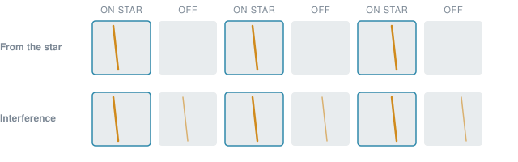
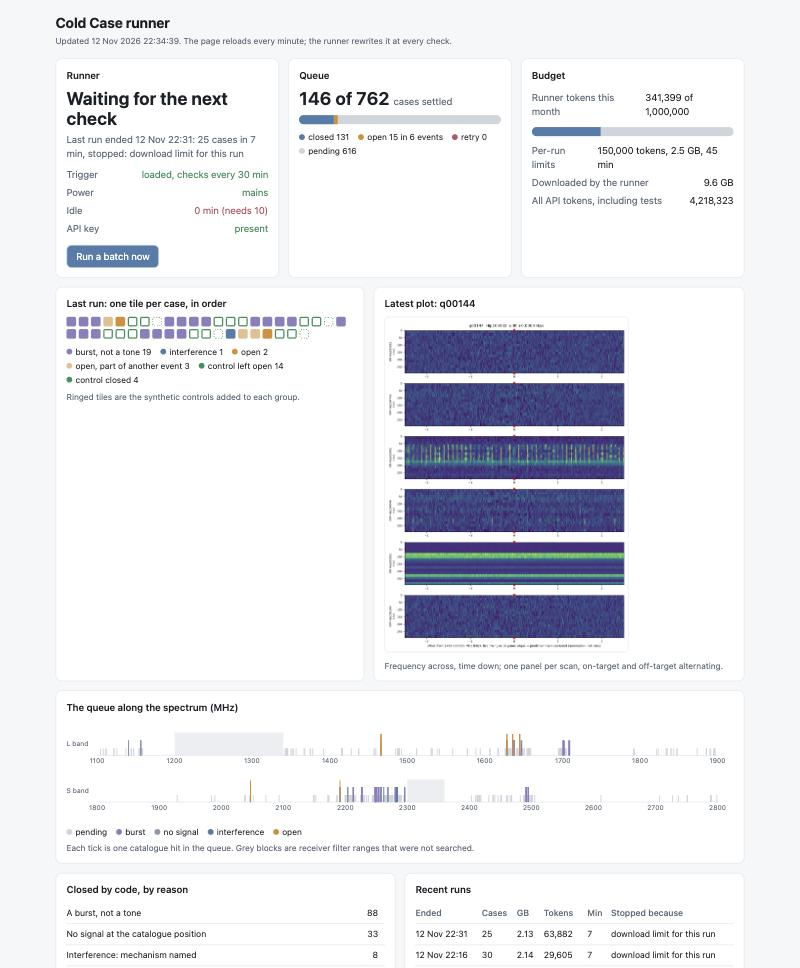
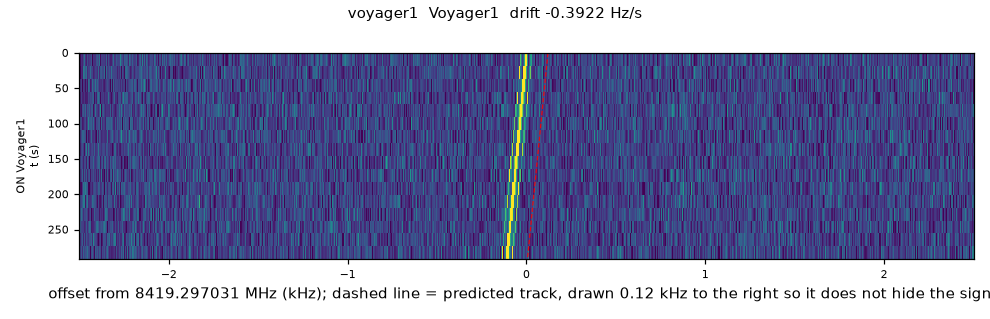
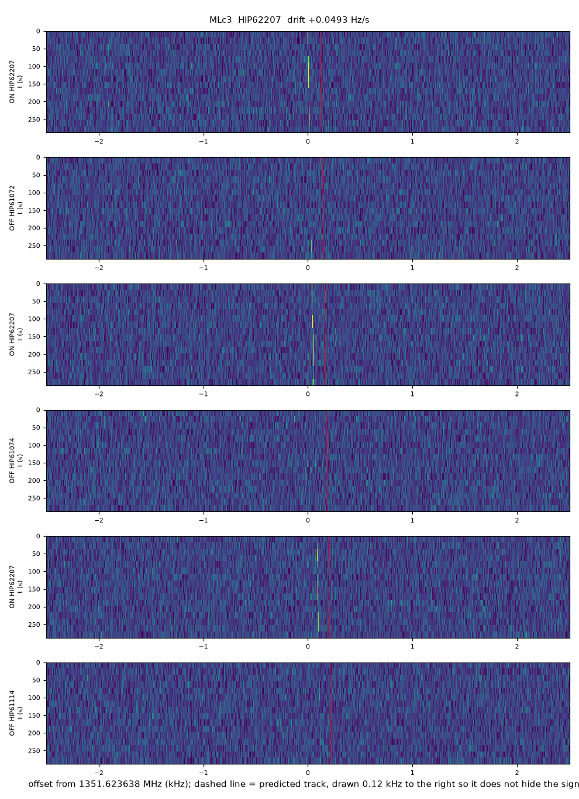

# Cold Case

A second look at radio signals that searches for alien technology threw away.

<p align="center">
  
</p>

Telescopes that listen for signals from other civilizations record millions of
candidate "hits". Almost all are our own technology: satellites, aircraft,
phones, the telescope's own electronics. To cope, search programs discard hits
with blunt automatic rules, and nobody records why each one was dropped.

[SETI@home](https://setiathome.berkeley.edu/) used people's idle computers to
find hits. This project uses idle computer and AI time for the step after
that: it goes back through the discard pile one case at a time and writes down
what each one really was.

It works on public data from [Breakthrough Listen](https://breakthroughinitiatives.org/opendatasearch)'s
survey of 1,327 nearby stars with the Green Bank Telescope.

> **Status: a hobby project, not peer-reviewed science.** One person and an AI
> coding assistant built it in a few days. The numbers below come from its own
> measurements, with thresholds chosen on small samples. Finding aliens this
> way is extremely unlikely; the point is the audit trail and the method.

## How it works

1. **Pick near-misses.** From the survey's public hit tables (about 47 million
   hits), select the ones that looked promising but were dropped by a rule: a
   signal seen in only one or two of the three on-star scans, or killed by an
   unrelated off-star hit nearby. After cuts, 762 cases are in the queue.
2. **Fetch a sliver.** The raw files are about 15 GB per scan. The pipeline
   reads only the storage chunk around the candidate with HTTP range requests,
   about 60 MB per scan.
3. **Measure, don't threshold.** For each of the six scans it measures the
   signal along the track predicted from the candidate's frequency and drift,
   and repeats the same measurement at about 45 control positions to know the
   noise floor. Off-star scans get the same careful look, and are also summed.
4. **Close only on direct evidence.** Code closes a case when it finds one of:

   | Evidence                     | Meaning                                                                  |
   | ---------------------------- | ------------------------------------------------------------------------ |
   | Seen off the star            | The same signal is measurable in scans pointed at empty sky              |
   | A comb at a round clock rate | Companion lines spaced by a round number of hertz: human electronics     |
   | Seen toward another star     | The same frequency and drift while the telescope looked elsewhere        |
   | A burst, not a tone          | All the power sits in one instant; the search mistook a flash for a tone |

   The band a signal sits in, or how busy it is, never closes a case. It only
   lowers its rank.

5. **Read and rank what stays open.** Two AI readers (an investigator and a
   challenger) write up each open event and rate it for follow-up. A small
   typed-judgment model, [Jev](https://docs.typesafe.ai/), is being evaluated
   as a cheaper ranker.
6. **Check itself continuously.** Every batch gets three hidden synthetic
   signals injected into the same data: two that should stay open and one weak
   leak that should be closed. The running score shows whether the rules still
   behave.

It runs unattended on a Mac when the machine is idle and plugged in, inside
limits for download volume, time and AI spending.

## What it has shown so far

Snapshot of 12 November 2026.

**Known answers**

| Case                                                                                                | What it is                                                                                                                     | Outcome here                                                                                                      |
| --------------------------------------------------------------------------------------------------- | ------------------------------------------------------------------------------------------------------------------------------ | ----------------------------------------------------------------------------------------------------------------- |
| Voyager 1 (GBT, 2016)                                                                               | A real, distant spacecraft                                                                                                     | Left open, as it should be. Measured drift -0.37 to -0.39 Hz/s against -0.374 predicted from Earth's motion alone |
| BLC1 (Parkes, 2019)                                                                                 | A famous false alarm toward Proxima Centauri, [traced to site electronics](https://www.nature.com/articles/s41550-021-01508-8) | Closed. Five other lines sit exactly where harmonics of one 2 MHz oscillator running 2.5 ppm fast would be        |
| Eight signals of interest from [Ma et al. 2023](https://www.nature.com/articles/s41550-022-01872-z) | Found by a deep-learning search; not re-detected in follow-up                                                                  | Five closed (four are measurable off the star, one recurs toward another star), three left open                   |

**Blind tests with injected signals**

| Test                                               | Sky-only signals left open | Wrongly closed by a rule | Weak leaks caught |
| -------------------------------------------------- | -------------------------- | ------------------------ | ----------------- |
| Pilot, 31 injections                               | 20 of 21                   | 0                        | 9 of 10           |
| Holdout, 30 fresh injections at random frequencies | 18 of 20                   | 0                        | 4 of 10           |
| Running controls, 60 so far                        | 35 of 40                   | 0                        | 16 of 20          |

The sky-only signals that were not left open were too weak to recover at all.
Leaks are caught less often in crowded bands, where the control levels are
higher; a missed leak stays on the open list.

**A lesson about AI readers.** With a prompt that asked "what is this signal
most likely?", two AI readers called 12 of 21 injected sky-only signals
interference, arguing from the band and the surroundings. After the rule
became "close only on direct evidence", they kept 20 of 21. The open-or-closed
decision now belongs to code, and the readers only rank.

**The queue.** 131 of 762 cases closed so far: 88 bursts, 33 with no signal at
the catalogue position, 8 lines of one comb, 2 seen off the star. Six events
are open, all rated low priority. One group of eight "candidates" turned out
to be lines spaced by exactly 131.072 kHz, which is 2<sup>17</sup> Hz: a
digital clock rate.

<p align="center">
  
</p>

## What the data looks like

Each plot shows frequency across and time down, one panel per scan.

| Voyager 1: one scan, the carrier drifting as the Earth turns                                   | A published signal of interest: clear on the star, and measurable off it                                      |
| ---------------------------------------------------------------------------------------------- | ------------------------------------------------------------------------------------------------------------- |
|  |  |

## Try it

Needs Python 3.12+, [uv](https://docs.astral.sh/uv/), and about 7 GB of disk.

```bash
uv sync

# 1. The survey's hit tables (2.7 GB, Zenodo record 7600403)
mkdir -p data/zenodo_7600403
curl -L -o data/zenodo_7600403/sband2019.tar.gz \
  "https://zenodo.org/records/7600403/files/sband2019.tar.gz?download=1"

# 2. Load them, find cadences, count near-misses
uv run python -I tools/load_hits.py data/zenodo_7600403/sband2019.tar.gz data/derived/hits
uv run python -I tools/strata.py data/derived/hits data/derived/work
uv run python -I tools/funnel.py data/derived/work/tracks_nonrfi_drifting.parquet

# 3. Investigate a known case and let code decide
uv run python -I -m coldcase.investigate cases/known/voyager1.json
uv run python -I -m coldcase.triage voyager1

# 4. Work the queue
uv run python -I -m coldcase.runner build-queue
uv run python -I -m coldcase.runner run --now --max-groups 1

# 5. Watch it
uv run python -I -m coldcase.serve      # http://localhost:8790
```

The AI steps are optional. Copy `.env.example` to `.env` and add an Anthropic
key for the readers and a TypeSafe key for Jev; without them the pipeline
still gathers evidence and decides open or closed. Spending limits are in
`runner.toml`. On macOS, `runner/install.sh runner` installs the idle-time
trigger.

## Layout

| Path                                               | What it holds                                                       |
| -------------------------------------------------- | ------------------------------------------------------------------- |
| `coldcase/remote.py`                               | Partial reads of Breakthrough Listen HDF5 and filterbank files      |
| `coldcase/dedoppler.py`                            | Drift search and forced measurement along a track                   |
| `coldcase/investigate.py`                          | Evidence bundle and plot for one case                               |
| `coldcase/checks.py`                               | Lookalikes, clock harmonics, band use, sky geometry, expected drift |
| `coldcase/triage.py`                               | The four direct-evidence rules                                      |
| `coldcase/controls.py`                             | Hidden synthetic signals for every batch                            |
| `coldcase/readers.py`, `agents/`                   | The two AI readers and their instructions                           |
| `coldcase/jev.py`, `coldcase/rank.py`              | Jev's questions and the rank score                                  |
| `coldcase/runner.py`, `runner/`                    | Unattended runner, limits, macOS triggers                           |
| `coldcase/dashboard.py`, `liveview.py`, `serve.py` | The dashboard                                                       |
| `tools/`                                           | One-off scripts: load hit tables, find cadences, build test sets    |
| `cases/known/`                                     | Case definitions for the known answers                              |

## Limits

- A signal seen in one observation can never be confirmed from that data
  alone. "Open" means "not explained by the checks here", nothing more.
- There is no check against satellite orbits, so a satellite crossing the
  beam during an on-star scan can stay open.
- The table of radio band uses was written from memory and is not verified.
- Thresholds were chosen on about ninety labelled test cases. The running
  controls are the real test of them.
- There are no unit tests yet.

## Data and credit

- Breakthrough Listen open data: [Lebofsky et al. 2019](https://arxiv.org/abs/1906.07391).
- Hit tables for the 1,327-star survey: [Price et al. 2020](https://zenodo.org/records/7600403), produced with [turboSETI](https://github.com/UCBerkeleySETI/turbo_seti).
- BLC1 verification framework: [Sheikh et al. 2021](https://www.nature.com/articles/s41550-021-01508-8).
- Deep-learning search and its eight signals: [Ma et al. 2023](https://www.nature.com/articles/s41550-022-01872-z).
- The idea of donating idle time: [SETI@home](https://setiathome.berkeley.edu/).

Built with [Claude Code](https://claude.com/claude-code). This project is not
affiliated with Breakthrough Listen, the SETI Institute or UC Berkeley.

## License

MIT. See [LICENSE](LICENSE).
