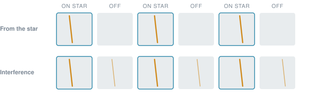

# Cold Case

A second look at radio signals that searches for alien technology threw away.

<p align="center">
  
</p>

Telescopes that listen for signals from other civilizations record millions of
candidate "hits". Almost all are our own technology: satellites, aircraft,
phones, the telescope's own electronics. To cope, search programs discard hits
with blunt automatic rules, and nobody records why each one was dropped.

[SETI@home](https://setiathome.berkeley.edu/) used people's idle computers to
find hits. This project uses idle computer and AI time for the step after
that: it goes back through the discard pile one case at a time and writes down
what each one really was.

It works on public data from [Breakthrough Listen](https://breakthroughinitiatives.org/opendatasearch)'s
survey of 1,327 nearby stars with the Green Bank Telescope.

> **Status: a hobby project, not peer-reviewed science.** One person and an AI
> coding assistant built it in a few days. The numbers below come from its own
> measurements, with thresholds chosen on small samples. Finding aliens this
> way is extremely unlikely; the point is the audit trail and the method.

## How it works

1. **Pick near-misses.** From the survey's public hit tables (about 47 million
   hits), select the ones that looked promising but were dropped by a rule: a
   signal seen in only one or two of the three on-star scans, or killed by an
   unrelated off-star hit nearby. After cuts, 762 cases are in the queue.
2. **Fetch a sliver.** The raw files are about 15 GB per scan. The pipeline
   reads only the storage chunk around the candidate with HTTP range requests,
   about 60 MB per scan.
3. **Measure, don't threshold.** For each of the six scans it measures the
   signal along the track predicted from the candidate's frequency and drift,
   and repeats the same measurement at about 45 control positions to know the
   noise floor. Off-star scans get the same careful look, and are also summed.
4. **Close only on direct evidence.** Code closes a case when it finds one of:

   | Evidence                     | Meaning                                                                                             |
   | ---------------------------- | --------------------------------------------------------------------------------------------------- |
   | Seen off the star            | The same signal is measurable in scans pointed at empty sky, on its track or within 300 Hz of it    |
   | A comb at a round clock rate | Companion lines spaced by a round number of hertz: human electronics                                |
   | Seen toward other stars      | The same frequency and drift while the telescope looked at two or more other stars                  |
   | A burst, not a tone          | The power sits in one instant and nothing is left without it; the search mistook a flash for a tone |
   | Harmonics of one clock       | Lines of one scan at different whole multiples of one clock rate, all the same fraction off nominal |

   The last row compares open events with each other, so it runs over the
   open list after each batch. So does a second pass of the comb test, for
   lines of one scan that came from different downloads. Two more kinds of
   evidence come from steps 5
   and 6: the signal is back at the same telescope frequency on another day,
   or it is there toward other stars in the same half hour.

   The band a signal sits in, or how busy it is, never closes a case. It only
   lowers its rank.

5. **Look again on other days.** When the star was observed again in the same
   band, the same spot is measured on those days at two frequencies: the one
   the telescope saw, where a local emitter would still be, and the one
   shifted by the Earth's motion, where a transmitter fixed in the sky would
   have moved to. A repeat at the first closes the case. A repeat at the
   second is flagged for a human and never decided by code. Seeing nothing
   changes nothing. This step is run by hand for now.
6. **Look at the same half hour.** The telescope moves to another star every
   few minutes. The event's frequency is measured in the scans of other stars
   made in the same band within 30 minutes of it. A line that is still there
   with the telescope pointed degrees away is local, and the case closes when
   unrelated lines are unlikely to explain the match. Seeing nothing changes
   nothing. A second check compares the line of sight, at the moment the
   signal was strongest, with the orbits of catalogued satellites. A close
   pass is flagged and never closes a case. Both are run by hand for now.
7. **Read and rank what stays open.** Two AI readers (an investigator and a
   challenger) write up each open event and rate it for follow-up. A score
   computed by code from the measurements orders the open list.
8. **Check itself continuously.** Every batch gets three hidden synthetic
   signals injected into the same data: two that should stay open and one weak
   leak that should be closed. The running score shows whether the rules still
   behave.

It runs unattended on a Mac when the machine is idle and plugged in, inside
limits for download volume, time and AI spending.

## What it has shown so far

Snapshot of 19 November 2026, after a full pass over the queue and one
full re-measurement (see "A drift-sign error" below).

**Known answers**

| Case                                                                                                | What it is                                                                                                                     | Outcome here                                                                                                      |
| --------------------------------------------------------------------------------------------------- | ------------------------------------------------------------------------------------------------------------------------------ | ----------------------------------------------------------------------------------------------------------------- |
| Voyager 1 (GBT, 2016)                                                                               | A real, distant spacecraft                                                                                                     | Left open, as it should be. Measured drift -0.37 to -0.39 Hz/s against -0.374 predicted from Earth's motion alone |
| BLC1 (Parkes, 2019)                                                                                 | A famous false alarm toward Proxima Centauri, [traced to site electronics](https://www.nature.com/articles/s41550-021-01508-8) | Closed. Five other lines sit exactly where harmonics of one 2 MHz oscillator running 2.5 ppm fast would be        |
| Eight signals of interest from [Ma et al. 2023](https://www.nature.com/articles/s41550-022-01872-z) | Found by a deep-learning search; not re-detected in follow-up                                                                  | Four closed, all measurable off the star; four left open                                                          |

**Blind tests with injected signals**

| Test                                               | Sky-only signals left open | Wrongly closed by a rule | Weak leaks caught |
| -------------------------------------------------- | -------------------------- | ------------------------ | ----------------- |
| Pilot, 31 injections                               | 20 of 21                   | 0                        | 9 of 10           |
| Holdout, 30 fresh injections at random frequencies | 18 of 20                   | 0                        | 4 of 10           |
| Running controls, 1,410 over the whole queue       | 879 of 940                 | 3                        | 336 of 470        |

In the first two tests, every sky-only signal that was not left open was too
weak to recover at all. Over the whole queue, 61 were not left open: 51 too
weak to recover, 7 hidden under a much stronger real signal at the same
place, and 3 closed by a rule. Those 3 were closed as seen off the star, all
in crowded satellite bands, where real interference crossed the track in an
off-star scan. That is 0.3% of the 882 recovered.

The count was 13 before the controls were examined one by one. Eight had
been closed as seen toward another star, each on a single weak catalogue hit
toward one other star that happened to lie within 300 Hz. On real signals
that rule alone had closed one case, which is what chance predicts, so it
now needs two other stars and a single one is only flagged. Two more were
scoring errors: the measurement had locked onto a stronger real signal
beside the injection. The two-star threshold was chosen on these same
controls and has not been tested on fresh ones. The known case MLc2 had
been closed on one such star and is open again.

The off-star test was widened after that. It used to look only within tens
of hertz of the predicted track. It now also closes a case when an off-star
scan's own detections hold a line at the candidate's drift within 300 Hz of
the predicted place, and an unrelated line that close is unlikely: under 5%,
counting the other lines of that drift in the off-star scans and never
assuming less than 1% per scan. The strength floor was set on one fixed half
of the controls and checked on the other. In the held-out half it fired on 1
of 453 sky-only signals, one the older test had already closed, and caught 1
more leak. The controls say little about slow drifts, where an ordinary
undrifting line counts as a match: only 66 of them drift that slowly. So the
window was also moved to places around the real cases where nothing is
predicted. There it fired in 16 of 3,642 tries, and in 9 of 402 for slow
drifts, all 9 beside cases that were already closed.

The burst rule was extended next. It closed a case when half or more of the
track's power sat in one time sample of about 18 seconds. Every case was then
measured again with its strongest sample left out. A steady signal barely
changes: no sky-only control kept less than 74% of its strength, and none
less than 82% in the half used to set the rule. The rule now also closes a
case when the track stood above its control windows on the whole scan, does
not without that one sample, and kept less than 70% of its strength. It
fires on none of the 883 recovered sky-only controls, in either half, and it
closed four more hits in the queue. Eight open events lose more than 30% but
still stand above their controls. They vary strongly, which is flagged in
the report and closes nothing.

The off-star test was extended once more on 20 November. A line counted as
present off the star only when it beat the strongest of its 46 control
windows. Where those windows hold lines of their own, such as the other
teeth of a comb the candidate belongs to, it cannot, however plainly it is
there. The test now also takes an off-star track of S/N 8 or more and asks
how likely an unrelated line that strong is to sit that close to the
predicted frequency, given how many of the control windows hold one. The
same unrelated line can be there in every scan, so the scans are not
multiplied together. Under 5%, the case closes. It closed 11 hits in 8
events, at chances of 0.7% to 3.8%. Two of the events (q00316, q00538) are
mirror images 2.538 MHz either side of 1837.5 MHz, each one tooth of a comb
with lines every 500 Hz, at S/N 140 to 260 in all three off-star scans. On
the 882 recovered sky-only controls the new part fires twice, both times on
a control the older parts had already closed, so chance predicts about 0.2
firings among the 97 hits that were open. It caught no leak the older parts
had missed. Four of the eight events rest on a single off-star scan.

Leaks are caught less often in crowded bands, where the control levels are
higher; a missed leak stays on the open list.

**A lesson about AI readers.** With a prompt that asked "what is this signal
most likely?", two AI readers called 12 of 21 injected sky-only signals
interference, arguing from the band and the surroundings. After the rule
became "close only on direct evidence", they kept 20 of 21. The open-or-closed
decision now belongs to code, and the readers only rank.

**A cheaper ranker that did not pay off.** A small typed-judgment model,
[Jev](https://docs.typesafe.ai/), answered six fixed questions about each
open case, as a possible replacement for the readers. The test was how often
it ranks an injected sky-only signal above a real open event (1.00 is
perfect, 0.50 is chance). On the 399 injected signals and 27 real events it
answered, Jev scored 0.80, the score computed by code 0.84, and the two
combined 0.86. On the 20 injections and 18 real events that the readers also
saw, the readers scored 0.99 and Jev 0.84. That reader figure comes from the
cases their instructions were tuned on, so it flatters them. Jev was removed:
it cost tokens and added 0.02 to a score that is free.

**A drift-sign error, found and fixed.** Until 19 November every case was
followed the wrong way. The survey's hit tables give each drift rate with the
opposite sign to the data, and the pipeline trusted that sign. It showed up
while two open events were being checked by hand: one line moved down 89 Hz
between two scans while its catalogue drift pointed up. The hit tables
confirm it on their own: of 1.04 million lines catalogued in two on-star
scans of one cadence, 98.8% moved against the catalogue's sign
(`tools/drift_sign.py`).

A wrong-way track crosses a steady line for an instant, so a steady line
looked like a burst, and the places predicted in the other five scans were
off. The hidden test signals could not catch it, because they are injected
with the pipeline's own sign. That is the lesson: the controls test the
rules, not the reading of someone else's catalogue.

The seed search now takes the stronger of the two signs, and all 2,181
stored cases (queue, controls, known answers) were measured again from
cached data, with no downloads. The known answers did not change. The
controls moved by one case. In the queue the seed moved to another track in
610 of 761 cases, and 125 changed status:

| Was                                 | Cases | Now                                             |
| ----------------------------------- | ----- | ----------------------------------------------- |
| Burst                               | 43    | Closed, seen off the star                       |
| Burst                               | 23    | Open                                            |
| No signal at the catalogue position | 20    | Open                                            |
| No signal at the catalogue position | 16    | Closed, burst                                   |
| Seen off the star or at other stars | 7     | Open                                            |
| Seen off the star                   | 3     | Closed, burst                                   |
| Open                                | 9     | Closed, seen off the star or toward other stars |
| Open                                | 4     | Closed, burst                                   |

**The queue.** Of the 762 cases, 675 are closed: 536 bursts, 23 with no
signal at the catalogue position, 91 seen off the star, 4 seen only toward
other stars in the same half hour, 21 lines of two clocks (below). One case
has no public data. The other 86 hits stay open and form 61 events.
Forty-five of them stand above their control windows in one on-star scan, 10
in two, 1 in all three and 5 in none.

The AI readers had rated every event that was open before the
re-measurement. Those ratings were made on the old measurements, so they
are kept only for the 11 events whose track and lines did not change: none
of the 11 is rated above low. The other 50 open events wait for the next
month's AI budget.

**Two events looked at by hand.** Both readers had rated two events medium.
One (q00707, 2258.417 MHz toward HIP15919) is explained: the hit table lists
a carrier 2.048 MHz above it in all six scans, on and off the star, which
flared a hundredfold in the one scan where the event appears, at the same
drift. The event is a spur of that carrier, about 200 times weaker. No rule
closes that pattern yet, so it is still on the open list. The other (q00671,
2051.617 MHz toward HIP36357) is the most interesting event so far, and
still unexplained. One line drifts steadily at -0.124 Hz/s through two
on-star scans 12 minutes apart, at S/N 75 and 134, and is absent from all
three off-star scans and from the third on-star scan. It also switches off
and on by itself while the telescope is on the star, so its absence off the
star does not show that it comes from the sky. It was absent three days
later. It sits in a band used for satellite uplinks.

**Other days.** Before the re-measurement, the star of 22 open events had
been observed again in the same band, and the signal was absent every time,
at the telescope frequency and at the Earth-shifted one. Those measurements
followed the old tracks, so the check was made again on the new ones. It is
done for 57 of the 61 open events and closed none. The star of 16 was
observed again in the same band, on 25 other days in all, and the signal was
absent every time, at both frequencies. For the other 41 there is no other
day that can tell a local signal from one in the sky. The last four events
are still being checked.

**The same half hour.** This check first ran on the 53 events that were open
at the time, on the old tracks. For 43 of them another star had been observed in the same band
within 30 minutes, 170 scans in all. The line was absent in 36 events. In
five it was there toward another star, 3 to 42 degrees away, and those
closed. One of the five has two matching scans; the other four have one
each, at a chance of 4 to 5% that an unrelated line explains it. In two more
events a scan holds a line at the same frequency, but stand-out lines are
common enough near them that one match does not count, and they stay open.
All five closed events had been left open by both AI readers.

After the re-measurement the check was made again, from cached data, for
the 36 cases whose track had changed. Five events are closed by it now. Four
are from the first five. The fifth of those, the weakest, lost its match on
the right track and is open again; one event that had shown nothing on the
wrong track now has a match and closed.

The check then ran on the 38 open events that had not had it, a download of
9.3 GB, and closed one more: a strong line 304 Hz from the event's
frequency toward a star 7 degrees away, six minutes earlier, in one of five
scans, at a chance of 4.9%. Six events are closed by this check in all. Of
the 61 events open now, 47 were absent toward other stars, 13 had no other
star within half an hour, and 1 has a match that does not count.

The chance of an unrelated line was measured on the same scans: a given
position holds a line that stands out in 0.3% of scans (25 in 7,820 control
windows). The rule uses 1% or the event's own rate, whichever is higher.

**Satellites.** The line of sight of each of those 53 events, at its
strongest moment, was compared with the orbit of every catalogued payload.
In two events a satellite was closer than it is in 95% of other moments of
the same night: Landsat 1 at 0.07 degrees and KazSat-1 at 0.11 degrees. Two
in 53 is what chance gives, and both satellites had been dead for years. So
the check found nothing, and it only flags.

It was made again on the new tracks for the 70 events open on 19 November.
Seven had a pass rarer than 5%, where chance gives three or four; seven or
more turn up by chance about 6% of the time. Six of the seven are still
open. Four of the payloads were launched between 1972 and 1992. The other
three are listed as working today, so they were working then: a GPS
satellite and two military communications satellites, 0.1 to 0.4 degrees
from the line of sight. One of those events is at 2264 MHz, inside the band
such satellites use for telemetry. The check still only flags.

**Two clocks.** One group of eight "candidates" turned out to be lines spaced
by exactly 131.072 kHz, which is 2<sup>17</sup> Hz: a digital clock rate.
Two more lines of the same scan sat 4 and 5 teeth below the eight, in the
next download, where the comb test could not see them. They had stayed open,
and one reader had rated their event medium. The test now also looks across
downloads and closed both. The survey's own hit table agrees: in that scan,
24 of the 29 catalogued hits within 60 teeth of the comb sit on a tooth, on
24 different teeth, and none do when the grid is shifted. With the grid moved
at random, the rule closes a line in 2 of 1,000 tries.

A second clock was hiding across the whole band. Eleven events that had
stayed open turned out to be one device. In five scans toward three stars,
between 29 February and 3 March 2016, the lines sit at whole multiples of
24 MHz (59, 62, 69 and 77 times). Within a scan every line is the same
fraction below nominal, to 0.1 ppm or better: a 24 MHz crystal running 70 to
103 ppm slow. The comb test had missed it because these lines are 72 to 240
MHz apart, far outside one download. The AI readers had read eight of the
eleven, one line at a time, and left all eight open.

The rule for this was written after the pattern was noticed, so it was
checked on data it had not used. At three other multiples of 24 MHz per scan,
the raw data hold a line at the predicted frequency in 13 of 15 measurements,
11 of them within 10 Hz. The survey's own hit table has a hit at 48 of 144
other predicted multiples, against 3 of 2,880 at shifted control positions.
The lines are also in some off-star scans, 200 to 300 Hz from the track and
outside the narrow window the off-star test followed then. The wider test
added later did not see them either: in 5 of the 11 lines an off-star scan
holds a strong line within 300 Hz, but drifting the other way. That was the
drift-sign error at work: the candidates were being followed the wrong way.

<p align="center">
  
</p>

## What the data looks like

Each plot shows frequency across and time down, one panel per scan.

| Voyager 1: one scan, the carrier drifting as the Earth turns                                   | A published signal of interest: clear on the star, and measurable off it                                      |
| ---------------------------------------------------------------------------------------------- | ------------------------------------------------------------------------------------------------------------- |
|  |  |

## Try it

Needs Python 3.12+, [uv](https://docs.astral.sh/uv/), and about 7 GB of disk.

```bash
uv sync

# 1. The survey's hit tables (2.7 GB, Zenodo record 7600403)
mkdir -p data/zenodo_7600403
curl -L -o data/zenodo_7600403/sband2019.tar.gz \
  "https://zenodo.org/records/7600403/files/sband2019.tar.gz?download=1"

# 2. Load them, find cadences, count near-misses
uv run python -I tools/load_hits.py data/zenodo_7600403/sband2019.tar.gz data/derived/hits
uv run python -I tools/strata.py data/derived/hits data/derived/work
uv run python -I tools/funnel.py data/derived/work/tracks_nonrfi_drifting.parquet

# 3. Investigate a known case and let code decide
uv run python -I -m coldcase.investigate cases/known/voyager1.json
uv run python -I -m coldcase.triage voyager1

# 4. Work the queue
uv run python -I -m coldcase.runner build-queue
uv run python -I -m coldcase.runner run --now --max-groups 1

# 5. Watch it
uv run python -I -m coldcase.serve      # http://localhost:8790

# 6. Look for an open event on the star's other observing days
uv run python -I -m coldcase.repeat CASE_ID

# 7. Look for harmonics of one clock among the open events, and for combs
#    whose lines came from different downloads (dry runs)
uv run python -I -m coldcase.harmonics
uv run python -I -m coldcase.combs

# 8. Check which way the hit tables' drift rates point, and measure every
#    stored case again from cached data (stage, then report, then apply)
uv run python -I tools/drift_sign.py
uv run python -I -m coldcase.remeasure stage
uv run python -I -m coldcase.remeasure report

#    Add a newer measurement to stored cases from cached data, then see what
#    today's rules make of them (dry runs)
uv run python -I -m coldcase.backfill
uv run python -I -m coldcase.runner recheck

# 9. Review every open event on one page (also linked from the dashboard)
uv run python -I -m coldcase.dossier    # writes report/dossier.html

# 10. Look for an open event's line toward other stars in the same half hour
uv run python -I -m coldcase.session CASE_ID

# 11. Compare an open event with satellite orbits. Needs the yearly element
#     files from Space-Track (free account) and CelesTrak's satcat.csv in
#     data/satellites/
uv run python -I -m coldcase.satellites index
uv run python -I -m coldcase.satellites CASE_ID
```

The AI steps are optional. Copy `.env.example` to `.env` and add an Anthropic
key for the readers; without it the pipeline still gathers evidence and
decides open or closed. Spending limits are in
`runner.toml`. On macOS, `runner/install.sh runner` installs the idle-time
trigger.

## Layout

| Path                                               | What it holds                                                       |
| -------------------------------------------------- | ------------------------------------------------------------------- |
| `coldcase/remote.py`                               | Partial reads of Breakthrough Listen HDF5 and filterbank files      |
| `coldcase/dedoppler.py`                            | Drift search and forced measurement along a track                   |
| `coldcase/investigate.py`                          | Evidence bundle and plot for one case                               |
| `coldcase/checks.py`                               | Lookalikes, clock harmonics, band use, sky geometry, expected drift |
| `coldcase/triage.py`                               | The direct-evidence rules                                           |
| `coldcase/repeat.py`                               | The repeat check on a star's other observing days                   |
| `coldcase/harmonics.py`                            | The clock-harmonic rule across open events                          |
| `coldcase/combs.py`                                | The comb test for lines of one scan in different downloads          |
| `coldcase/session.py`                              | The same line toward other stars within half an hour                |
| `coldcase/satellites.py`                           | Catalogued satellites near the line of sight at the signal's peak   |
| `coldcase/backfill.py`                             | Adds a newer measurement to stored evidence from cached cutouts     |
| `coldcase/remeasure.py`                            | Measures every stored case again from cached cutouts and applies it |
| `coldcase/controls.py`                             | Hidden synthetic signals for every batch                            |
| `coldcase/readers.py`, `agents/`                   | The two AI readers and their instructions                           |
| `coldcase/rank.py`                                 | The rank score for open events                                      |
| `coldcase/runner.py`, `runner/`                    | Unattended runner, limits, macOS triggers                           |
| `coldcase/dashboard.py`, `liveview.py`, `serve.py` | The dashboard                                                       |
| `coldcase/dossier.py`                              | Every open event on one page, for a person to review                |
| `tools/`                                           | One-off scripts: load hit tables, find cadences, build test sets    |
| `cases/known/`                                     | Case definitions for the known answers                              |

## Limits

- A signal seen in one observation can never be confirmed from that data
  alone. "Open" means "not explained by the checks here", nothing more.
- The repeat check applies to few events: most stars were observed on one day
  per receiver band. Not seeing a signal again proves little, since a
  transmitter on an orbiting planet would be shifted by an unknown amount.
- The off-star test looks on the track predicted from the on-star scan and
  for a line of the same drift within 300 Hz of it. A local line whose drift
  changes between scans escapes it, and so does a fast drifter (several Hz/s),
  whose place a few minutes later cannot be predicted that well. In a crowded
  band one nearby line is not enough, and the event stays open.
- Where the comparison windows hold lines of their own, the off-star test
  goes by how close the off-star line sits to the predicted frequency. That
  assumes unrelated lines are spread evenly over those windows. Four of the
  eight events it closed rest on one off-star scan, two of them at a chance
  above 3%.
- Fifty of the 61 open events have no AI reading of their present
  measurements.
- The wide search for lines of the same drift near each case was made at the
  catalogue's sign and has not been redone; it only feeds the ranking.
- The flash test leaves out one time sample. A signal that is on for two or
  three samples and off for the rest is not caught by it.
- The clock rule tries whole numbers of MHz from 4 to 50 and needs two lines
  in one scan. Four single lines near a multiple of the same clock were
  flagged and stayed open; the session check later closed two of them.
- The comb test across downloads needs a comb that is already closed, or four
  open lines in one scan. A closed comb's grid comes from a few lines, so a
  tooth far from them can fall outside the 120 Hz allowed and be missed.
- The session check needs another star observed within 30 minutes: 13 of the
  61 open events had none. Five of its six closures rest on one matching
  scan, the weakest of them 3.6 above its control windows, and three of
  them sit at a chance of 4.9%, just under the limit.
- The satellite check knows catalogued payloads only, from orbits published
  up to 7 days from the observation. It cannot tell a working satellite from
  a dead one, and it cannot see one picked up far from the beam by the
  telescope's sidelobes.
- The table of radio band uses was written from memory and is not verified.
- Thresholds were chosen on about ninety labelled test cases. The running
  controls are the real test of them: the rules closed 3 of 882 recovered
  sky-only signals that should have stayed open, and missed 131 of 466 weak
  leaks. The two-star threshold of the other-star rule was chosen on those
  same controls.
- There are no unit tests yet.

## Data and credit

- Breakthrough Listen open data: [Lebofsky et al. 2019](https://arxiv.org/abs/1906.07391).
- Hit tables for the 1,327-star survey: [Price et al. 2020](https://zenodo.org/records/7600403), produced with [turboSETI](https://github.com/UCBerkeleySETI/turbo_seti).
- BLC1 verification framework: [Sheikh et al. 2021](https://www.nature.com/articles/s41550-021-01508-8).
- Deep-learning search and its eight signals: [Ma et al. 2023](https://www.nature.com/articles/s41550-022-01872-z).
- The idea of donating idle time: [SETI@home](https://setiathome.berkeley.edu/).

Built with [Claude Code](https://claude.com/claude-code). This project is not
affiliated with Breakthrough Listen, the SETI Institute or UC Berkeley.

## License

MIT. See [LICENSE](LICENSE).
