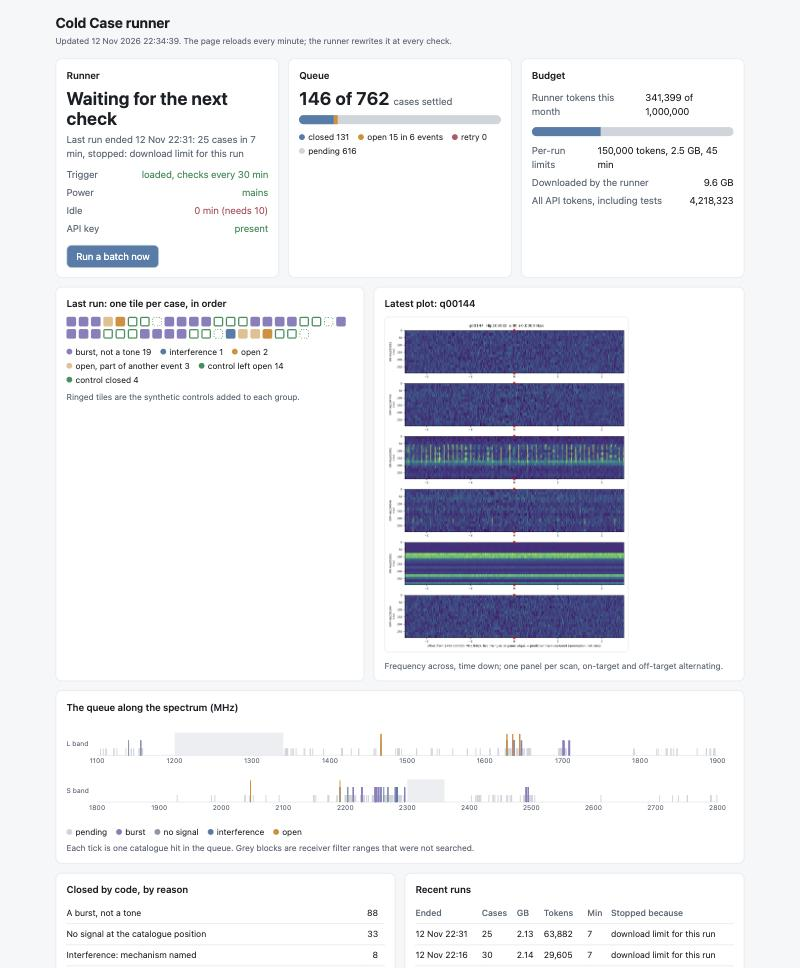
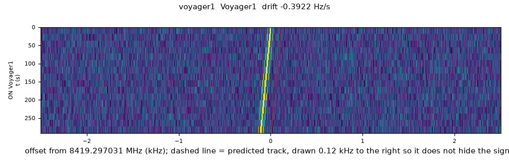
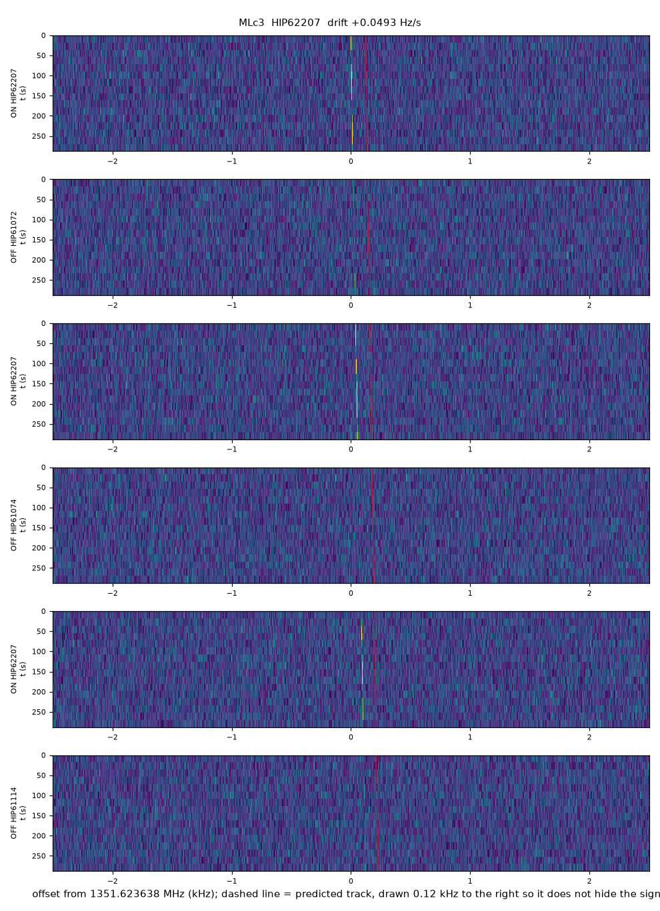

# Cold Case

A second look at radio signals that searches for alien technology threw away.

<p align="center">
  
</p>

Telescopes that listen for signals from other civilizations record millions of
candidate "hits". Almost all are our own technology: satellites, aircraft,
phones, the telescope's own electronics. To cope, search programs discard hits
with blunt automatic rules, and nobody records why each one was dropped.

[SETI@home](https://setiathome.berkeley.edu/) used people's idle computers to
find hits. This project uses idle computer and AI time for the step after
that: it goes back through the discard pile one case at a time and writes down
what each one really was.

It works on public data from [Breakthrough Listen](https://breakthroughinitiatives.org/opendatasearch)'s
survey of 1,327 nearby stars with the Green Bank Telescope.

> **Status: a hobby project, not peer-reviewed science.** One person and an AI
> coding assistant built it in a few days. The numbers below come from its own
> measurements, with thresholds chosen on small samples. Finding aliens this
> way is extremely unlikely; the point is the audit trail and the method.

## How it works

1. **Pick near-misses.** From the survey's public hit tables (about 47 million
   hits), select the ones that looked promising but were dropped by a rule: a
   signal seen in only one or two of the three on-star scans, or killed by an
   unrelated off-star hit nearby. After cuts, 762 cases are in the queue.
2. **Fetch a sliver.** The raw files are about 15 GB per scan. The pipeline
   reads only the storage chunk around the candidate with HTTP range requests,
   about 60 MB per scan.
3. **Measure, don't threshold.** For each of the six scans it measures the
   signal along the track predicted from the candidate's frequency and drift,
   and repeats the same measurement at about 45 control positions to know the
   noise floor. Off-star scans get the same careful look, and are also summed.
4. **Close only on direct evidence.** Code closes a case when it finds one of:

   | Evidence                     | Meaning                                                                                             |
   | ---------------------------- | --------------------------------------------------------------------------------------------------- |
   | Seen off the star            | The same signal is measurable in scans pointed at empty sky, on its track or within 300 Hz of it    |
   | A comb at a round clock rate | Companion lines spaced by a round number of hertz: human electronics                                |
   | Seen toward other stars      | The same frequency and drift while the telescope looked at two or more other stars                  |
   | A burst, not a tone          | All the power sits in one instant; the search mistook a flash for a tone                            |
   | Harmonics of one clock       | Lines of one scan at different whole multiples of one clock rate, all the same fraction off nominal |

   The last row compares open events with each other, so it runs over the
   open list after each batch. One more kind of evidence comes from step 5:
   the signal is back at the same telescope frequency on another day.

   The band a signal sits in, or how busy it is, never closes a case. It only
   lowers its rank.

5. **Look again on other days.** When the star was observed again in the same
   band, the same spot is measured on those days at two frequencies: the one
   the telescope saw, where a local emitter would still be, and the one
   shifted by the Earth's motion, where a transmitter fixed in the sky would
   have moved to. A repeat at the first closes the case. A repeat at the
   second is flagged for a human and never decided by code. Seeing nothing
   changes nothing. This step is run by hand for now.
6. **Read and rank what stays open.** Two AI readers (an investigator and a
   challenger) write up each open event and rate it for follow-up. A score
   computed by code from the measurements orders the open list.
7. **Check itself continuously.** Every batch gets three hidden synthetic
   signals injected into the same data: two that should stay open and one weak
   leak that should be closed. The running score shows whether the rules still
   behave.

It runs unattended on a Mac when the machine is idle and plugged in, inside
limits for download volume, time and AI spending.

## What it has shown so far

Snapshot of 17 November 2026, after the first full pass over the queue.

**Known answers**

| Case                                                                                                | What it is                                                                                                                     | Outcome here                                                                                                      |
| --------------------------------------------------------------------------------------------------- | ------------------------------------------------------------------------------------------------------------------------------ | ----------------------------------------------------------------------------------------------------------------- |
| Voyager 1 (GBT, 2016)                                                                               | A real, distant spacecraft                                                                                                     | Left open, as it should be. Measured drift -0.37 to -0.39 Hz/s against -0.374 predicted from Earth's motion alone |
| BLC1 (Parkes, 2019)                                                                                 | A famous false alarm toward Proxima Centauri, [traced to site electronics](https://www.nature.com/articles/s41550-021-01508-8) | Closed. Five other lines sit exactly where harmonics of one 2 MHz oscillator running 2.5 ppm fast would be        |
| Eight signals of interest from [Ma et al. 2023](https://www.nature.com/articles/s41550-022-01872-z) | Found by a deep-learning search; not re-detected in follow-up                                                                  | Four closed, all measurable off the star; four left open                                                          |

**Blind tests with injected signals**

| Test                                               | Sky-only signals left open | Wrongly closed by a rule | Weak leaks caught |
| -------------------------------------------------- | -------------------------- | ------------------------ | ----------------- |
| Pilot, 31 injections                               | 20 of 21                   | 0                        | 9 of 10           |
| Holdout, 30 fresh injections at random frequencies | 18 of 20                   | 0                        | 4 of 10           |
| Running controls, 1,410 over the whole queue       | 880 of 940                 | 3                        | 336 of 470        |

In the first two tests, every sky-only signal that was not left open was too
weak to recover at all. Over the whole queue, 60 were not left open: 52 too
weak to recover, 5 hidden under a much stronger real signal at the same
place, and 3 closed by a rule. Those 3 were closed as seen off the star, all
in crowded satellite bands, where real interference crossed the track in an
off-star scan. That is 0.3% of the 883 recovered.

The count was 13 before the controls were examined one by one. Eight had
been closed as seen toward another star, each on a single weak catalogue hit
toward one other star that happened to lie within 300 Hz. On real signals
that rule alone had closed one case, which is what chance predicts, so it
now needs two other stars and a single one is only flagged. Two more were
scoring errors: the measurement had locked onto a stronger real signal
beside the injection. The two-star threshold was chosen on these same
controls and has not been tested on fresh ones. The known case MLc2 had
been closed on one such star and is open again.

The off-star test was widened after that. It used to look only within tens
of hertz of the predicted track. It now also closes a case when an off-star
scan's own detections hold a line at the candidate's drift within 300 Hz of
the predicted place, and an unrelated line that close is unlikely: under 5%,
counting the other lines of that drift in the off-star scans and never
assuming less than 1% per scan. The strength floor was set on one fixed half
of the controls and checked on the other. In the held-out half it fired on 1
of 453 sky-only signals, one the older test had already closed, and caught 1
more leak. The controls say little about slow drifts, where an ordinary
undrifting line counts as a match: only 66 of them drift that slowly. So the
window was also moved to places around the real cases where nothing is
predicted. There it fired in 16 of 3,642 tries, and in 9 of 402 for slow
drifts, all 9 beside cases that were already closed.

Leaks are caught less often in crowded bands, where the control levels are
higher; a missed leak stays on the open list.

**A lesson about AI readers.** With a prompt that asked "what is this signal
most likely?", two AI readers called 12 of 21 injected sky-only signals
interference, arguing from the band and the surroundings. After the rule
became "close only on direct evidence", they kept 20 of 21. The open-or-closed
decision now belongs to code, and the readers only rank.

**A cheaper ranker that did not pay off.** A small typed-judgment model,
[Jev](https://docs.typesafe.ai/), answered six fixed questions about each
open case, as a possible replacement for the readers. The test was how often
it ranks an injected sky-only signal above a real open event (1.00 is
perfect, 0.50 is chance). On the 399 injected signals and 27 real events it
answered, Jev scored 0.80, the score computed by code 0.84, and the two
combined 0.86. On the 20 injections and 18 real events that the readers also
saw, the readers scored 0.99 and Jev 0.84. That reader figure comes from the
cases their instructions were tuned on, so it flatters them. Jev was removed:
it cost tokens and added 0.02 to a score that is free.

**The queue.** All 762 cases have had a first pass, and 689 are closed: 579
bursts, 59 with no signal at the catalogue position, 32 seen off the star, 19
lines of two clocks (below). One case has no public data. The other 72 hits
stay open and form 56 events. The AI readers have rated 14 of those so far:
none high, and one got a medium from one of the two readers. The other 42
wait for the next month's reading budget. The wider off-star test closed two
of the 32; three more events have a line near the predicted place in an
off-star scan but sit in bands too crowded for one match to count, and are
flagged in the report.

**Other days.** For 22 of the events that stayed open, the star was observed
again in the same band. The signal was absent every time, at the telescope
frequency and at the Earth-shifted one, so none of them closed and none was
flagged.

**Two clocks.** One group of eight "candidates" turned out to be lines spaced
by exactly 131.072 kHz, which is 2<sup>17</sup> Hz: a digital clock rate.

A second clock was hiding across the whole band. Eleven events that had
stayed open turned out to be one device. In five scans toward three stars,
between 29 February and 3 March 2016, the lines sit at whole multiples of
24 MHz (59, 62, 69 and 77 times). Within a scan every line is the same
fraction below nominal, to 0.1 ppm or better: a 24 MHz crystal running 70 to
103 ppm slow. The comb test had missed it because these lines are 72 to 240
MHz apart, far outside one download. The AI readers had read eight of the
eleven, one line at a time, and left all eight open.

The rule for this was written after the pattern was noticed, so it was
checked on data it had not used. At three other multiples of 24 MHz per scan,
the raw data hold a line at the predicted frequency in 13 of 15 measurements,
11 of them within 10 Hz. The survey's own hit table has a hit at 48 of 144
other predicted multiples, against 3 of 2,880 at shifted control positions.
The lines are also in some off-star scans, 200 to 300 Hz from the track and
outside the narrow window the off-star test followed then. The wider test
added since still does not see them: in 5 of the 11 lines an off-star scan
holds a strong line within 300 Hz, but drifting the other way, so the clock's
rate was changing from scan to scan.

<p align="center">
  
</p>

## What the data looks like

Each plot shows frequency across and time down, one panel per scan.

| Voyager 1: one scan, the carrier drifting as the Earth turns                                   | A published signal of interest: clear on the star, and measurable off it                                      |
| ---------------------------------------------------------------------------------------------- | ------------------------------------------------------------------------------------------------------------- |
|  |  |

## Try it

Needs Python 3.12+, [uv](https://docs.astral.sh/uv/), and about 7 GB of disk.

```bash
uv sync

# 1. The survey's hit tables (2.7 GB, Zenodo record 7600403)
mkdir -p data/zenodo_7600403
curl -L -o data/zenodo_7600403/sband2019.tar.gz \
  "https://zenodo.org/records/7600403/files/sband2019.tar.gz?download=1"

# 2. Load them, find cadences, count near-misses
uv run python -I tools/load_hits.py data/zenodo_7600403/sband2019.tar.gz data/derived/hits
uv run python -I tools/strata.py data/derived/hits data/derived/work
uv run python -I tools/funnel.py data/derived/work/tracks_nonrfi_drifting.parquet

# 3. Investigate a known case and let code decide
uv run python -I -m coldcase.investigate cases/known/voyager1.json
uv run python -I -m coldcase.triage voyager1

# 4. Work the queue
uv run python -I -m coldcase.runner build-queue
uv run python -I -m coldcase.runner run --now --max-groups 1

# 5. Watch it
uv run python -I -m coldcase.serve      # http://localhost:8790

# 6. Look for an open event on the star's other observing days
uv run python -I -m coldcase.repeat CASE_ID

# 7. Look for harmonics of one clock among the open events (dry run)
uv run python -I -m coldcase.harmonics
```

The AI steps are optional. Copy `.env.example` to `.env` and add an Anthropic
key for the readers; without it the pipeline still gathers evidence and
decides open or closed. Spending limits are in
`runner.toml`. On macOS, `runner/install.sh runner` installs the idle-time
trigger.

## Layout

| Path                                               | What it holds                                                       |
| -------------------------------------------------- | ------------------------------------------------------------------- |
| `coldcase/remote.py`                               | Partial reads of Breakthrough Listen HDF5 and filterbank files      |
| `coldcase/dedoppler.py`                            | Drift search and forced measurement along a track                   |
| `coldcase/investigate.py`                          | Evidence bundle and plot for one case                               |
| `coldcase/checks.py`                               | Lookalikes, clock harmonics, band use, sky geometry, expected drift |
| `coldcase/triage.py`                               | The direct-evidence rules                                           |
| `coldcase/repeat.py`                               | The repeat check on a star's other observing days                   |
| `coldcase/harmonics.py`                            | The clock-harmonic rule across open events                          |
| `coldcase/controls.py`                             | Hidden synthetic signals for every batch                            |
| `coldcase/readers.py`, `agents/`                   | The two AI readers and their instructions                           |
| `coldcase/rank.py`                                 | The rank score for open events                                      |
| `coldcase/runner.py`, `runner/`                    | Unattended runner, limits, macOS triggers                           |
| `coldcase/dashboard.py`, `liveview.py`, `serve.py` | The dashboard                                                       |
| `tools/`                                           | One-off scripts: load hit tables, find cadences, build test sets    |
| `cases/known/`                                     | Case definitions for the known answers                              |

## Limits

- A signal seen in one observation can never be confirmed from that data
  alone. "Open" means "not explained by the checks here", nothing more.
- The repeat check applies to few events: most stars were observed on one day
  per receiver band. Not seeing a signal again proves little, since a
  transmitter on an orbiting planet would be shifted by an unknown amount.
- The off-star test looks on the track predicted from the on-star scan and
  for a line of the same drift within 300 Hz of it. A local line whose drift
  changes between scans escapes it, as the 24 MHz clock did. In a crowded
  band one nearby line is not enough, and the event stays open.
- The clock rule tries whole numbers of MHz from 4 to 50 and needs two lines
  in one scan. Four single lines near a multiple of the same clock are
  flagged and stay open.
- There is no check against satellite orbits, so a satellite crossing the
  beam during an on-star scan can stay open.
- The table of radio band uses was written from memory and is not verified.
- Thresholds were chosen on about ninety labelled test cases. The running
  controls are the real test of them: the rules closed 3 of 883 recovered
  sky-only signals that should have stayed open, and missed 131 of 466 weak
  leaks. The two-star threshold of the other-star rule was chosen on those
  same controls.
- There are no unit tests yet.

## Data and credit

- Breakthrough Listen open data: [Lebofsky et al. 2019](https://arxiv.org/abs/1906.07391).
- Hit tables for the 1,327-star survey: [Price et al. 2020](https://zenodo.org/records/7600403), produced with [turboSETI](https://github.com/UCBerkeleySETI/turbo_seti).
- BLC1 verification framework: [Sheikh et al. 2021](https://www.nature.com/articles/s41550-021-01508-8).
- Deep-learning search and its eight signals: [Ma et al. 2023](https://www.nature.com/articles/s41550-022-01872-z).
- The idea of donating idle time: [SETI@home](https://setiathome.berkeley.edu/).

Built with [Claude Code](https://claude.com/claude-code). This project is not
affiliated with Breakthrough Listen, the SETI Institute or UC Berkeley.

## License

MIT. See [LICENSE](LICENSE).
